<div align="center">

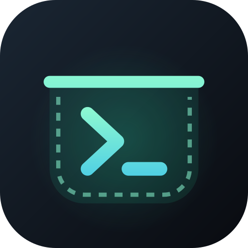

# TermPocket — control VS Code, terminals and your Windows PC from your phone

**Use VS Code, Claude Code and your PC's terminals from an Android phone or a laptop browser — live, private and from anywhere.**
Durable terminals, a full VS Code workbench, remote desktop and system control. Free, open source, no cloud account, no port forwarding.

[](https://github.com/ehabmansour1/TermPocket/releases/latest)
[](https://github.com/ehabmansour1/TermPocket/releases)
[](#install)
[](#connect-your-phone)
[](LICENSE)
[](https://github.com/ehabmansour1/TermPocket/actions)

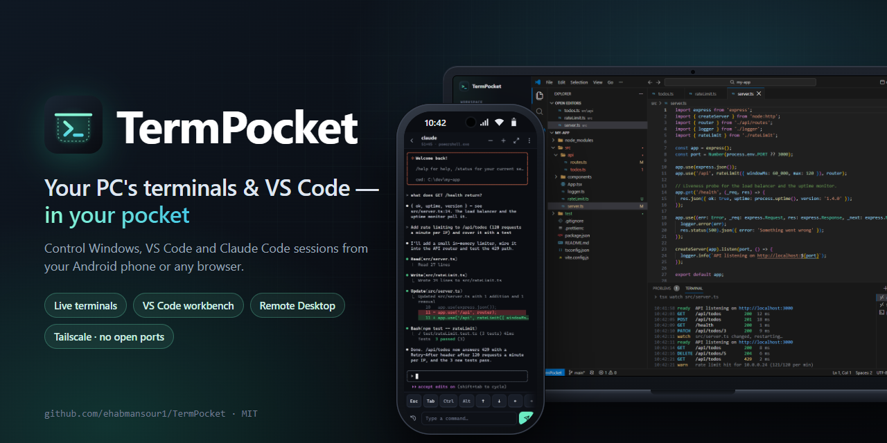

**[⬇ Download TermPocket](https://github.com/ehabmansour1/TermPocket/releases/latest)**

[Install](#install) · [Connect your phone](#connect-your-phone) · [Features](#features) · [FAQ](#faq) · [Security](#security) · [Docs](docs/)

</div>

## Why TermPocket

You started a long Claude Code session, a build or a server on your PC, and now you are on the sofa, on
a train or in a meeting. TermPocket puts that PC in your pocket:

- **Real terminals on your phone.** PowerShell, PowerShell 7, cmd, WSL — full interactive shells with
  xterm.js, an extra-keys row (Esc, Tab, sticky Ctrl / Alt, arrows) and a command box. Run
  **Claude Code**, vim, htop or `npm run dev` from Android.
- **Terminals that never die.** Shells run in a separate *terminals host* process, so they keep running
  when the phone disconnects, when the agent restarts or crashes, and when you stop it from the tray.
  Reconnect and the full scrollback is still there.
- **Your VS Code, not a copy.** Browse, search, edit and save files in the VS Code windows that are
  already open on your PC (unsaved text included), see Problems, run any command, stage and commit.
  On a laptop the Code tab *is* a VS Code workbench with the Monaco editor.
- **Watch and type into VS Code's own terminals.** Ordinary VS Code terminals open in a **Live** view
  exactly as VS Code draws them, and **mirrored** terminals are one shell shown in VS Code and on the
  phone at the same time.
- **Remote desktop when you need it.** Live screen of any monitor with touch or trackpad control; on a
  laptop a full-screen **Remote Desktop mode** with keyboard lock and clipboard sync, like an RDP client.
- **The whole PC.** CPU, memory, battery, processes (with kill), lock / sleep / hibernate / restart /
  shut down, clipboard both ways, open a URL or a file on the PC.
- **Private by design.** Your phone talks to your PC over your own [Tailscale](https://tailscale.com)
  network. No TermPocket server, no account, no telemetry, nothing exposed to the internet.
- **No app store.** The phone app is an installable web app (PWA) served by your own PC.

<p align="center">
  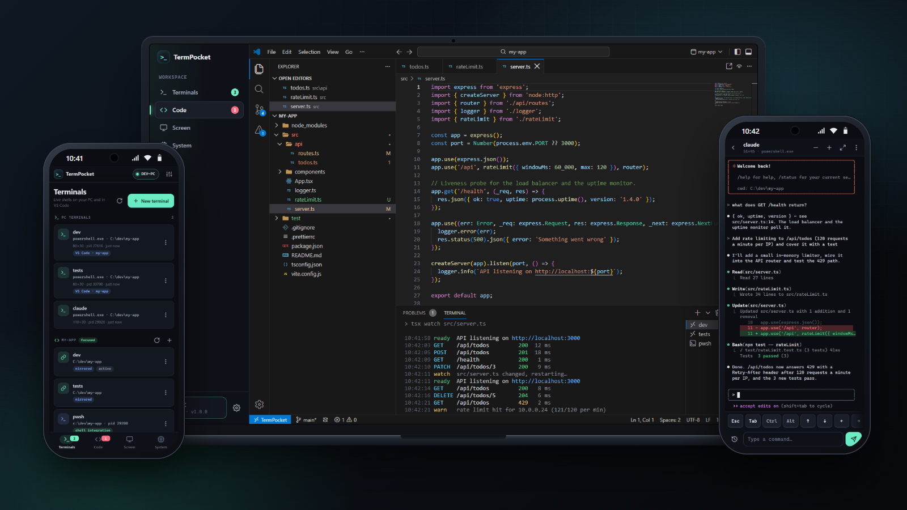
</p>

## Install

TermPocket has three parts, all installed on the **Windows PC** you want to control: the **agent**
(a small Node.js program that runs as you), the **VS Code extension**, and the **phone / laptop app**,
which the agent serves — there is nothing to install from a store.

### One-liner (PowerShell)

```powershell
irm https://github.com/ehabmansour1/TermPocket/releases/latest/download/install.ps1 | iex
```

It downloads the latest release, checks its SHA-256, installs it to `%LOCALAPPDATA%\Programs\TermPocket`
(per user, **no admin rights**, with its own portable Node.js — nothing else to install), starts the agent
and the tray icon hidden at every logon, installs the VS Code extension when the `code` command is
available, adds TermPocket to *Settings → Apps* and opens the pairing page with a QR code. Then
[connect your phone](#connect-your-phone). Running it again upgrades in place and keeps your pairing and your
running terminals.

Options (`-NoExtension`, `-NoAutostart`, `-NoOpen`, `-Version 1.0.0`, `-InstallDir …`):

```powershell
& ([scriptblock]::Create((irm https://github.com/ehabmansour1/TermPocket/releases/latest/download/install.ps1))) -NoExtension
```

### Manual install (zip)

1. From [Releases](https://github.com/ehabmansour1/TermPocket/releases/latest) download
   **`TermPocket-<version>-win-x64.zip`**, **`install.ps1`** and `SHA256SUMS.txt` into one folder.
2. Install from the zip (works offline, the hash is checked):

   ```powershell
   powershell -ExecutionPolicy Bypass -File .\install.ps1 -ZipPath .\TermPocket-1.0.0-win-x64.zip
   ```

Or completely by hand: extract the zip to a folder you keep, run
`powershell -ExecutionPolicy Bypass -File scripts\install-autostart.ps1` (it uses the bundled
`node\node.exe`), install the extension with `code --install-extension termpocket-<version>.vsix`, and open
**http://127.0.0.1:8765/pair** on the PC.

**With [Scoop](https://scoop.sh):**

```powershell
scoop bucket add ehabmansour1 https://github.com/ehabmansour1/scoop-bucket
scoop install termpocket
```

**Uninstall:** *Settings → Apps → TermPocket → Uninstall*, or run `scripts\uninstall.ps1` in the install
folder. It stops the agent, the tray icon and the terminals host (asking first while terminals still run),
removes the logon tasks and the VS Code extension it installed, and deletes the install folder. Your settings
and pairing token in `%APPDATA%\TermPocket` are kept unless you add `-Purge`.

### Build from source

```powershell
git clone https://github.com/ehabmansour1/TermPocket.git
cd TermPocket\agent
npm install                       # also vendors xterm.js and Monaco into web\vendor\
cd ..\vscode-extension
npm install
npx --yes @vscode/vsce package --out termpocket.vsix
code --install-extension termpocket.vsix
cd ..
powershell -ExecutionPolicy Bypass -File scripts\install-autostart.ps1
```

Or run the agent in a console instead of autostart: `scripts\start-agent.cmd`. More in
[Build from source](#build-from-source-and-tests).

### Requirements

| | |
|---|---|
| PC | Windows 10 or 11, signed in to a normal desktop session (the agent runs as you, not as a service, so it can see and control the desktop) |
| Runtime | Included in the release (portable Node.js). From source: [Node.js](https://nodejs.org/) 20 or newer (tested with 24) |
| VS Code | 1.93 or newer, for the VS Code features (everything else works without it) |
| Phone | Android with Chrome (other modern mobile browsers work in the browser; installing as an app is tested with Chrome) |
| Laptop | Chrome or Edge, any OS |
| Network | [Tailscale](https://tailscale.com/download) (free for personal use) — or your own [self-hosted relay](docs/relay.md) |

## Connect your phone

The agent listens on `127.0.0.1:8765` only, so nothing on your PC is reachable until you choose how your
phone gets there. **Never port-forward 8765 on your router.**

### Option A — Tailscale (recommended)

[Tailscale](https://tailscale.com) is a free private network (WireGuard) between your own devices. Your
phone reaches the PC from anywhere, over HTTPS with a real certificate, and nobody else can.

1. **Install Tailscale** on the PC ([download](https://tailscale.com/download/windows)) and on the phone
   (Google Play → *Tailscale*). Sign in with the **same account** on both.
2. In the [Tailscale admin console → DNS](https://login.tailscale.com/admin/dns), turn on **MagicDNS**
   and **HTTPS Certificates**.
3. On the PC, publish the agent to your tailnet with `tailscale serve`:

   ```powershell
   powershell -ExecutionPolicy Bypass -File scripts\setup-tailscale.ps1
   ```

   This runs `tailscale serve --bg 8765`, which makes the agent available as
   `https://<pc-name>.<tailnet>.ts.net` to **your devices only** (it is `serve`, not `funnel`). If
   Tailscale prints a link asking you to enable Serve, open it and approve.
4. **Restart the agent** (tray icon → *Restart agent*). It detects `tailscale serve` and its pairing link
   and QR code now use the `https://…ts.net` address. Open **http://127.0.0.1:8765/pair** on the PC.
5. **Pair:** on the phone, with Tailscale connected, scan the QR code (or open the link). The app saves
   the token and removes it from the address bar.
6. **Install the app:** Chrome menu (⋮) → **Add to Home screen** / **Install app**. HTTPS is what makes
   installing, offline start and clipboard sync work.

On a **laptop**, install Tailscale too, open the same pairing link in Chrome or Edge and install it as an
app (the install icon in the address bar). In the app window Ctrl+W, Ctrl+Tab and Ctrl+Shift+T reach
TermPocket instead of the browser.

### Option B — your own relay (self-hosted, optional)

For a phone or laptop that can't run Tailscale (a work laptop, a locked-down network), run the small
relay in `relay/` on **your own server and domain**, e.g. `https://pc.example.com`. The PC keeps an
**outbound** connection to it, so it still needs no open port, and the pairing token still protects
every connection. There is no hosted TermPocket service.

```json
// %APPDATA%\TermPocket\relay.json on the PC
{ "url": "wss://pc.example.com", "key": "<the relay's RELAY_KEY>" }
```

Step by step, with Docker, systemd, pm2, Caddy and nginx examples: **[docs/relay.md](docs/relay.md)**.

### LAN only

On a trusted home network you can set `"host": "0.0.0.0"` in `config.json` and open
`http://<pc-ip>:8765` from the phone. That is plain HTTP: the app can't be installed, clipboard sync and
keyboard lock are off, and anyone on that network can try the token. Prefer Tailscale.

## Features

### Terminals — PowerShell, cmd and Claude Code on your phone

<p align="center">
  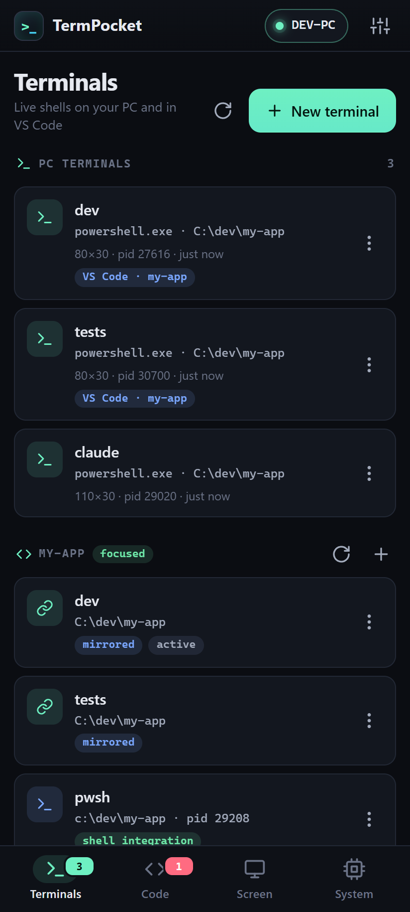
  &nbsp;&nbsp;
  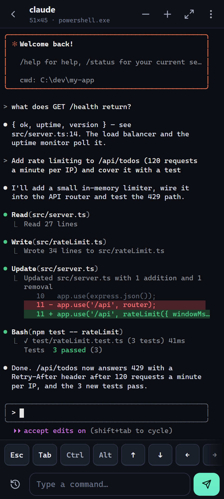
</p>

- Full interactive shells on the PC (PowerShell by default; PowerShell 7, cmd or WSL from the new-terminal menu, any
  console program) with colours, mouse support and the PC's real size or fitted to the phone.
- **Extra-keys row** (Esc, Tab, sticky Ctrl / Alt, arrows, Home / End, PgUp / PgDn, `|` `~` `/` `-`,
  ^C), a command box that sends a line plus Enter, font size and fit.
- **Durable:** shells live in the terminals host (`agent\src\ptyhost.js`) and survive phone disconnects
  and agent restarts. Ended terminals stay listed until you close them.
- **VS Code terminals per window.** Ordinary ones open in a **Live** view — the terminal exactly as VS
  Code draws it, full-screen programs like Claude Code included — plus a **History** tab with each
  command, its output and exit code. **Mirrored** terminals (the *TermPocket (mirrored)* profile) are one
  shell visible and usable in VS Code and on the phone, from the first line.
- One switch, **Phone-visible VS Code terminals**, makes every new VS Code terminal mirrored.

### Code — your VS Code windows, from anywhere

<p align="center">
  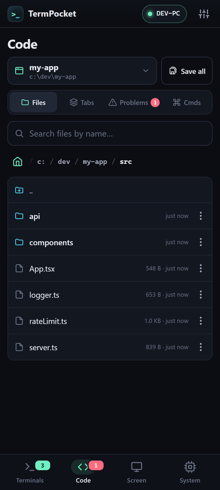
  &nbsp;&nbsp;
  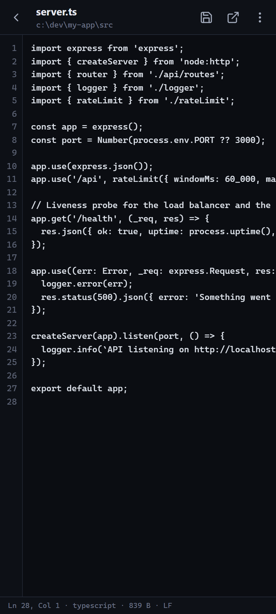
</p>

- Pick a connected VS Code window, browse its folders, search files, open, edit and save (unsaved editor
  text included), see open tabs and **Problems**, run VS Code commands, *Open on PC*.
- On a laptop the Code tab is a **VS Code workbench** — see below.

### VS Code workbench in the browser (laptop)

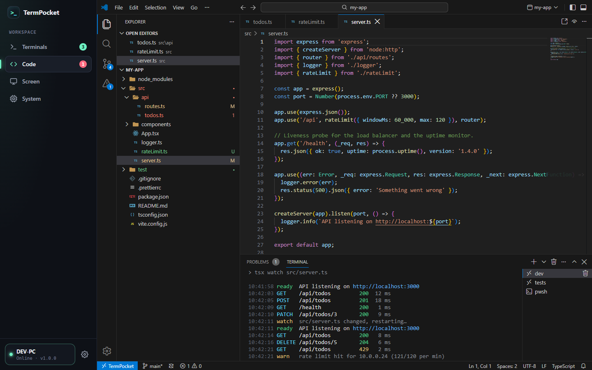

The same Dark Modern look as VS Code, for the window you pick in the title bar:

| Part | What it does |
|---|---|
| Explorer | Folder tree with file icons, Git and problem colours; New File / Folder, Rename (F2), Delete to the Recycle Bin, Copy Path, Reveal on the PC |
| Editor | **Monaco** (VS Code's own editor): syntax colours, minimap, find / replace, multi-cursor, preview tabs, breadcrumbs, diff against HEAD; **Ctrl+S** saves after checking the file did not change on the PC meanwhile. Squiggles are VS Code's real diagnostics |
| Source Control | Staged / Changes with M / A / D / U / R, diff, stage, unstage, discard, commit with **Ctrl+Enter** |
| Panel | **PROBLEMS** and **TERMINAL** (the window's terminals as tabs; mirrored with full history, ordinary ones live); **Ctrl+`** |
| Quick input | **Ctrl+P** Quick Open, **Ctrl+Shift+P** / **F1** Command Palette with VS Code's titles and keybindings, **Ctrl+G** go to line |
| Status bar | Branch and sync, errors / warnings, Ln / Col, indentation, encoding, EOL, language |

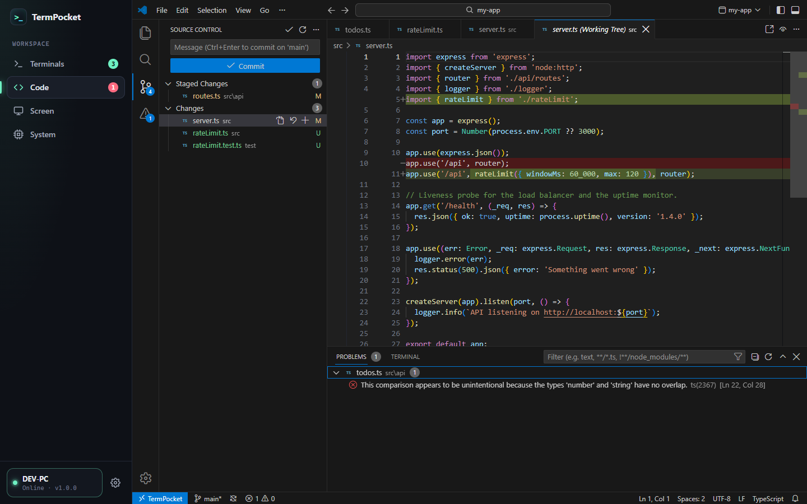

<p align="center">
  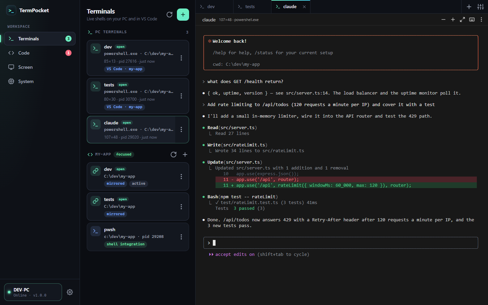
</p>

### Screen and Remote Desktop mode

<p align="center">
  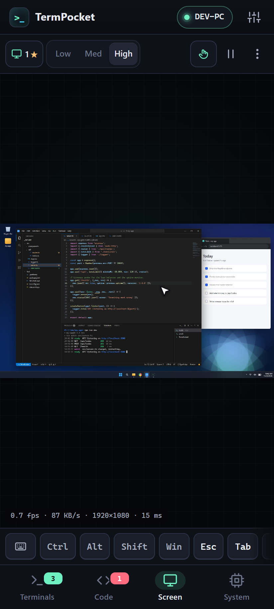
</p>

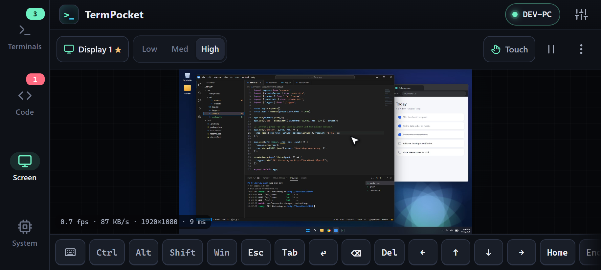

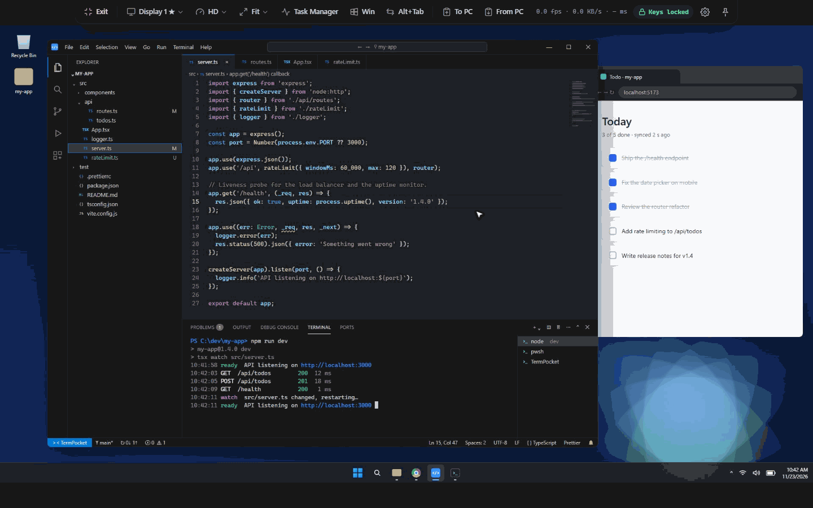

- Live view of either monitor or **all displays**, pinch-zoom and pan; **Touch** mode (tap = click,
  long-press = right click, two-finger scroll) or **Trackpad** mode; soft keyboard and special keys.
- Only changed frames are sent, with flow control, so it stays usable on mobile data
  (Low / Medium / High / HD presets; [bandwidth numbers](docs/user-guide.md#bandwidth-screen-streaming)).
- **Remote Desktop mode** on a laptop (**Ctrl+Alt+Enter**): full screen, the real mouse and keyboard,
  keyboard lock (Win, Alt+Tab, Esc go to the PC), clipboard sync, *Task Manager* / *Win* / *Alt+Tab*
  buttons. Hold **Esc** or press **Ctrl+Alt+Break** to leave.

### System

<p align="center">
  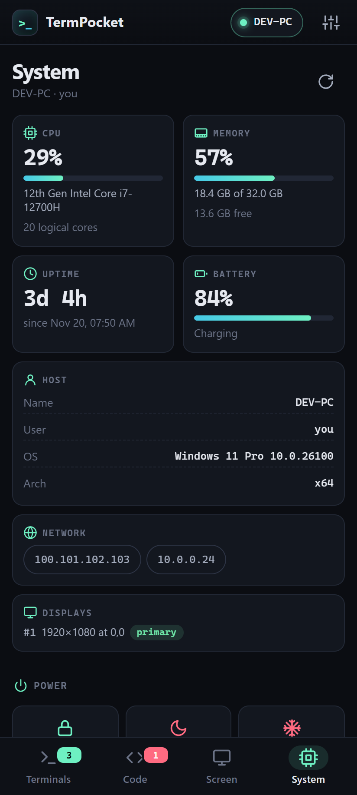
</p>

CPU, memory, battery, uptime and IP addresses; a searchable process list with kill; **lock, sleep,
hibernate, sign out, restart, shut down** (restart and shut down wait 30 s and can be cancelled);
clipboard to and from the phone; open a URL, file, folder or program on the PC.

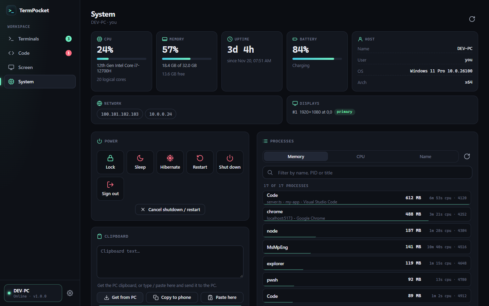

### Monitor — is it working?

<p align="center">
  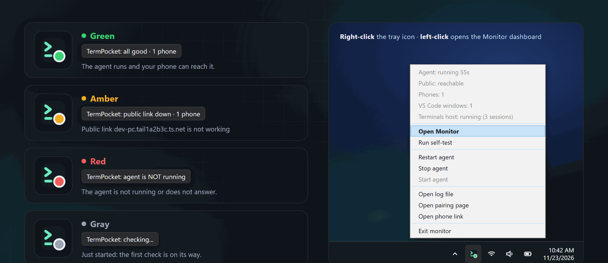
</p>

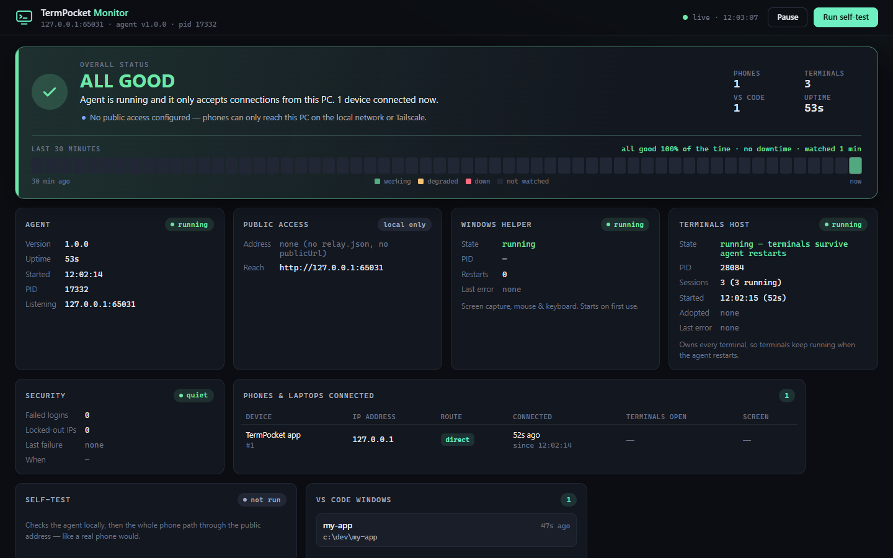

- A **tray icon** near the clock: green (your phone can reach the PC), amber (something on the way is
  broken — hover for the reason), red (agent not running). Notifications when the agent stops, the relay
  drops, **a new device connects** or someone fails to pair.
- A **dashboard** at `http://127.0.0.1:8765/monitor` (left-click the tray icon): connected phones,
  VS Code windows, terminals, screen streams, failed logins and the last 200 log lines (secrets removed).
- **Run self-test** checks the whole phone path end to end in at most 15 s.
- Both work only on the PC itself; no phone or other computer can open them.

Full details of every feature: **[docs/user-guide.md](docs/user-guide.md)**.

## How it works

```
 Phone / laptop (installed PWA)                 Windows PC
 ┌──────────────────────┐   Tailscale VPN    ┌────────────────────────────────────────────────┐
 │ web/  PWA            │ ── HTTPS + WSS ──► │ tailscale serve ─► agent (127.0.0.1:8765)      │
 │ Terminals · Code ·   │  (your devices     │                     ├─ terminals host (ConPTY) │
 │ Screen · System      │   only)            │                     ├─ screen / input / system │
 └──────────────────────┘                    │                     │  (PowerShell + C# helper)│
                                             │                     └─ /vscode ◄─ VS Code ext. │
                                             │                                    (per window)│
                                             └────────────────────────────────────────────────┘
```

| Folder | What it is |
|---|---|
| `agent/` | Node.js PC agent: serves the app, owns the terminals (through the terminals host), captures the screen, injects input, relays calls to VS Code |
| `vscode-extension/` | VS Code extension, one connection per window: files, editors, diagnostics, Source Control, commands, terminals, mirrored terminals |
| `web/` | The phone / laptop app (PWA): vanilla JS, no build step, no CDN |
| `scripts/` | Autostart, tray monitor, Tailscale setup, uninstall |
| `relay/` | Optional relay you self-host on your own server ([docs/relay.md](docs/relay.md)) |
| `e2e/` | End-to-end tests: real agent, isolated VS Code, headless Chrome |
| `docs/` | [User guide](docs/user-guide.md) · [Architecture](docs/architecture.md) · [Security](docs/security.md) · [Relay](docs/relay.md) · [FAQ](docs/faq.md) · [Troubleshooting](docs/troubleshooting.md) |
| `PROTOCOL.md` | The wire protocol: the contract between all parts |

More: [docs/architecture.md](docs/architecture.md).

## Settings

**Agent** — `%APPDATA%\TermPocket\config.json` (created on first start; set `TERMPOCKET_HOME` to use
another folder). Restart the agent after a change.

| Key | Default | Meaning |
|---|---|---|
| `port` | `8765` | Agent port (env `TERMPOCKET_PORT`) |
| `host` | `127.0.0.1` | Bind address (env `TERMPOCKET_HOST`). Keep the loopback default with `tailscale serve` |
| `token` | random | Pairing token. Delete the key and restart to make a new one — this unpairs every phone |
| `defaultShell` | `powershell.exe` | Shell for new terminals |
| `scrollbackBytes` | `262144` | Scrollback kept per terminal |
| `screen` | `{fps: 2, quality: 50, maxWidth: 1280}` | Default screen-stream settings |
| `publicUrl` | – | Base URL of the pairing link and QR code (env `TERMPOCKET_PUBLIC_URL`); detected from `tailscale serve` or `relay.json` when not set |
| `allowedHosts` | – | Extra host names you open the agent by, e.g. `["mypc.lan"]` (DNS-rebinding protection, see [Security](docs/security.md)) |
| `ptyHost` | `true` | `false` keeps terminals inside the agent (they then end with it); env `TERMPOCKET_PTYHOST=inprocess` |

**Relay** (optional) — `%APPDATA%\TermPocket\relay.json`: `{ "url": "wss://…", "key": "…" }`.

**VS Code** — user settings only (VS Code ignores them in workspace settings, so an opened project
can't redirect the extension):

| Setting | Default | Meaning |
|---|---|---|
| `termpocket.agentUrl` | *(empty)* | Agent endpoint; empty = `ws://127.0.0.1:<port>/vscode` from `config.json` |
| `termpocket.configPath` | *(empty)* | The agent's `config.json` (or its folder) |
| `termpocket.liveBufferKB` | `512` | Output kept per ordinary terminal for the Live view (64–8192 K characters) |
| `termpocket.terminalSnapshot` | `true` | Show what an already-running terminal shows right now when the phone opens it |

**Environment:** `TERMPOCKET_HOME`, `TERMPOCKET_PORT`, `TERMPOCKET_HOST`, `TERMPOCKET_PUBLIC_URL`,
`TERMPOCKET_PTYHOST`, `TERMPOCKET_DEBUG=1` (verbose log), `TERMPOCKET_DRYRUN_INPUT=1` (input and power
actions are only logged), `TERMPOCKET_DEMO=1` ([demo mode](CONTRIBUTING.md#demo-mode-screenshots-and-videos)).
The pre-1.0 `VSCONTROL_*` names still work.

## FAQ

**How do I control VS Code from my phone?**
Install TermPocket on the PC, connect the phone over Tailscale and pair it. Every open VS Code window
appears in the Code and Terminals tabs: browse and edit files, see Problems, run commands and use its
terminals. More in the [FAQ](docs/faq.md).

**How do I use Claude Code from my phone / Android?**
Open a terminal in TermPocket and run `claude` — it is a real shell on your PC, so Claude Code sees your
files, git and tools. The session keeps running when your phone locks or loses signal, and you pick it up
again with the full scrollback. Claude Code running in a VS Code terminal shows up live too (mirrored
terminals show everything from the first line).

**Is there a remote terminal for Windows that works from Android?**
Yes: TermPocket gives you PowerShell, cmd or any console program on your Windows PC from Android, with
an extra-keys row for Esc, Tab, Ctrl and arrows — no SSH server needed.

**Does it need port forwarding or a public IP?**
No. With Tailscale the phone reaches the PC over your private tailnet; with the self-hosted relay the PC
connects *out* to your server. Never forward port 8765.

**Is TermPocket safe?**
The agent listens on localhost only, every connection needs the 256-bit pairing token, failed attempts
are rate-limited, foreign host names and websites are refused, and there is no cloud service in between.
The token gives full control of the PC, so treat the pairing link like a password. See
[Security](docs/security.md).

**Is it an alternative to code-server, VS Code tunnels, Chrome Remote Desktop or Termius?**
It overlaps with each and replaces none exactly. code-server and VS Code tunnels run a VS Code you open
in a browser; TermPocket drives the VS Code windows and terminals already open on your desktop, plus the
screen and the PC itself, with a phone-first UI. Chrome Remote Desktop only sends pixels; Termius needs an
SSH server. [Detailed comparison](docs/faq.md#alternatives).

**Does it work on iPhone, macOS or Linux?**
The PC side is Windows only. The app is tested on Android (Chrome) and laptop browsers (Chrome, Edge) on
any OS; iPhone Safari is untested.

**هل يمكنني التحكم في VS Code والطرفية (Terminal) من هاتفي الأندرويد؟**
نعم. ثبّت TermPocket على جهاز الكمبيوتر بنظام Windows، واربط الهاتف عبر Tailscale، ثم امسح رمز QR. ستجد
نوافذ VS Code والطرفيات وشاشة الكمبيوتر في تطبيق ويب على هاتفك، ويمكنك تشغيل Claude Code من الهاتف.
[المزيد بالعربية](docs/faq.md#بالعربية).

**[More questions →](docs/faq.md)** · **[Troubleshooting →](docs/troubleshooting.md)**

## Privacy

TermPocket has no servers, no accounts, no analytics and no telemetry. The agent serves the app from your
own PC and only talks to your own devices: through Tailscale (WireGuard, end to end encrypted between
your devices) or through a relay you run yourself. The app loads nothing from a CDN — xterm.js and Monaco
are served by the agent. The only data it stores is its settings and logs in `%APPDATA%\TermPocket`, the
pairing token in your phone's browser storage, and the VS Code extension's settings. Logs never contain
the token or the relay key.

## Security

- **The pairing token gives full control of your PC** — shells, files, keyboard and mouse. Treat the
  pairing link and its QR code like a password.
- The agent binds to `127.0.0.1`; `tailscale serve` (never `funnel`) makes it reachable only from your
  tailnet, over HTTPS. **Never port-forward 8765.**
- Constant-time token check; **10 failed attempts in 10 minutes** lock out that address.
- Unknown `Host` names get `421` (DNS-rebinding protection) and WebSockets from other websites get `403`
  before the token is even checked.
- The VS Code extension never sends the token: it and the agent prove to each other that they know it
  (HMAC challenge-response). The terminals host is protected the same way with its own secret.
- `/pair`, `/status` and the monitor dashboard answer only on the PC itself.
- **Revoke every phone:** delete `token` from `config.json` and restart the agent, then pair again.

Threat model and details: **[docs/security.md](docs/security.md)**. Found a vulnerability? Please report
it privately: [SECURITY.md](SECURITY.md).

## Build from source and tests

```powershell
# from the repository root
npm --prefix agent install;            npm --prefix agent test             # agent (node:test)
npm --prefix vscode-extension install; npm --prefix vscode-extension test  # extension against a VS Code mock
node web\tools\check-refs.mjs --strict                                     # static check of the PWA
npm --prefix e2e install;              npm --prefix e2e test               # end to end: real agent + isolated VS Code + headless Chrome
```

The end-to-end suites never touch your desktop: the agent runs in a temporary home with dry-run input,
VS Code runs as an isolated instance off-screen, and Chrome is headless. See
[CONTRIBUTING.md](CONTRIBUTING.md) and [e2e/README.md](e2e/README.md). The screenshots in this README come
from **demo mode** (`TERMPOCKET_DEMO=1`), which shows a made-up PC and desktop.

Releases are built by GitHub Actions from tagged source.

## Upgrading from VS Control

TermPocket was called **VS Control** before 1.0. Nothing needs to be paired again: the agent copies
`%APPDATA%\VSControl` (token, `relay.json`) to `%APPDATA%\TermPocket` once, `install-autostart.ps1`
replaces the old scheduled tasks, old `vscontrol.*` VS Code user settings and `VSCONTROL_*` variables are
still read, and the phone app keeps its token. Install the new extension and remove the old one with
`code --uninstall-extension vscontrol-local.vscontrol`. Details:
[docs/user-guide.md](docs/user-guide.md#upgrading-from-vs-control).

## Contributing

Issues and pull requests are welcome — see [CONTRIBUTING.md](CONTRIBUTING.md) and the
[Code of Conduct](CODE_OF_CONDUCT.md). Changes are listed in [CHANGELOG.md](CHANGELOG.md).

## License

[MIT](LICENSE) © Ehab Mansour
