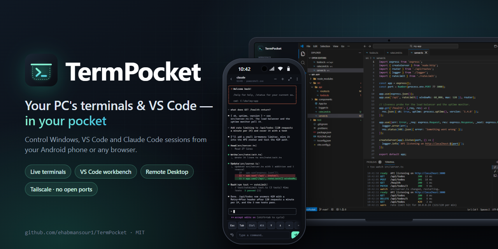
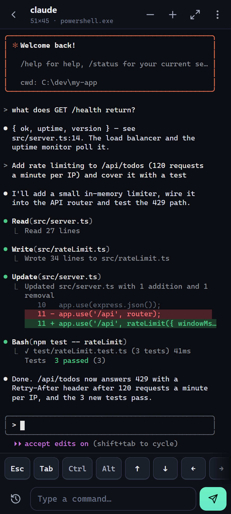
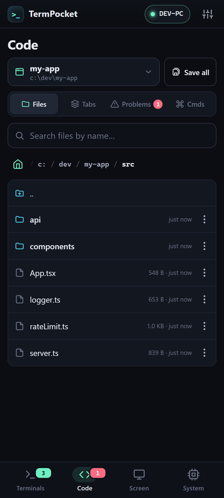
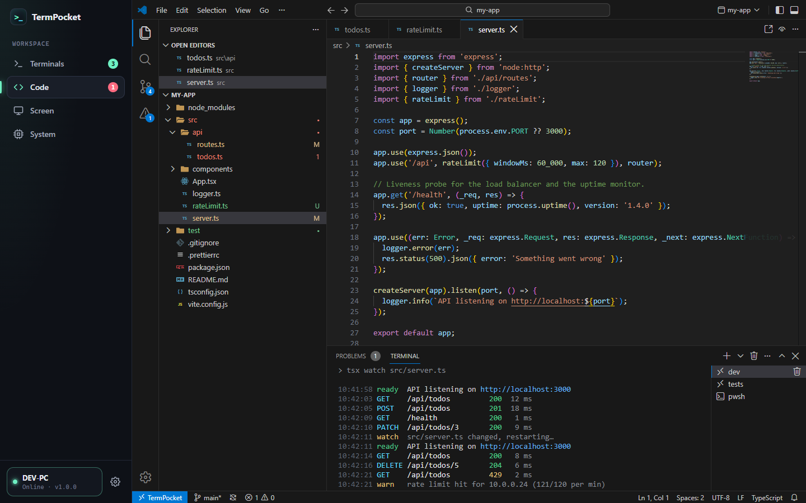

# TermPocket — VS Code & terminals from your phone

**Control VS Code from your phone or another computer.** Browse and edit files, see Problems, use Source
Control, run commands, and watch and type into your VS Code terminals — **Claude Code**, vim and htop
included — from an Android phone or a laptop browser. Private over Tailscale, no port forwarding, no cloud
service.

[](https://github.com/ehabmansour1/TermPocket/releases/latest)
[](https://github.com/ehabmansour1/TermPocket/blob/main/LICENSE)



This extension is one part of [**TermPocket**](https://github.com/ehabmansour1/TermPocket): a small agent on
your Windows PC plus an installable web app for your phone. The extension connects every VS Code window to
the TermPocket agent running on the same PC — **install the agent first**
([install guide](https://github.com/ehabmansour1/TermPocket#install)).

## What you can do from your phone

- **Files and editors:** browse, search, read and edit files (unsaved editor text included), open, save
  and close editors, see open tabs and the active editor.
- **Problems:** VS Code's real errors and warnings, with a jump to the line.
- **Source Control:** changes, diffs, stage, unstage, discard and commit — through VS Code's own Git.
- **Commands:** the Command Palette with VS Code's titles and keybindings; run any command in that window.
- **Live terminals:** ordinary VS Code terminals open **live** on the phone, exactly as VS Code draws them
  (full-screen apps like Claude Code included), and you can type into them. Each command's output and exit
  code is in a History view.
- **Mirrored terminals:** one shell, visible and usable in VS Code *and* on the phone, from the first line,
  surviving VS Code reloads and agent restarts.

<p align="center">
  
  &nbsp;
  
</p>

On a laptop, the TermPocket app shows your VS Code window as a full **VS Code workbench in the browser**
(explorer, Monaco editor, Source Control, PROBLEMS and TERMINAL panel, Quick Open):



## Setup

1. **Install and start the TermPocket agent** on this PC
   ([install](https://github.com/ehabmansour1/TermPocket#install)). It creates
   `%APPDATA%\TermPocket\config.json` with the pairing token.
2. **Install this extension** (ID `ehabmansour1.termpocket`), e.g. `code --install-extension termpocket.vsix`.
3. The status bar shows **TermPocket** when connected and a disconnected icon when not. Click it for
   **Reconnect**, **New mirrored terminal**, **Make new terminals phone-visible** and **Show pairing info**.
4. **Pair your phone** with the agent ([connect your phone](https://github.com/ehabmansour1/TermPocket#connect-your-phone)).
   Your VS Code windows appear in the app's Code and Terminals tabs.

The extension reads the token from the agent's `config.json` on every connection attempt, so it connects
automatically as soon as the agent runs (also when the agent is started or re-paired after VS Code). It
retries forever with a 1 s to 30 s backoff.

## Security

- **The token is never sent.** The extension first asks the agent to prove it knows the token (HMAC over a
  fresh nonce) and only then answers with its own proof. If something else is listening on the agent port,
  it is refused and nothing in the window is served to it.
- **Workspaces can't redirect it.** All settings are application-scoped (user settings only): a project's
  `.vscode/settings.json` can't point the extension at another server.
- It connects only to the agent on `127.0.0.1`. Nothing is sent anywhere else; no telemetry.

More: [TermPocket security model](https://github.com/ehabmansour1/TermPocket/blob/main/docs/security.md).

## Settings

| Setting | Default | Meaning |
|---|---|---|
| `termpocket.agentUrl` | *(empty)* | Agent endpoint. Empty → `ws://127.0.0.1:<port>/vscode` from `config.json` (port 8765 by default). |
| `termpocket.configPath` | *(empty)* | Agent `config.json` (or its folder). Empty → `%TERMPOCKET_HOME%\config.json`, else `%APPDATA%\TermPocket\config.json`. |
| `termpocket.liveBufferKB` | `512` | Recent output (K characters, 64–8192) kept per ordinary terminal for the phone's Live view. |
| `termpocket.terminalSnapshot` | `true` | When the phone opens an ordinary terminal whose output was not captured, send what it shows right now (select all → copy → clipboard text restored; the terminal panel is revealed briefly; skipped while the clipboard holds an image, files or rich text, which a text restore would lose). |

All settings are application-scoped. Changing `liveBufferKB` does not reconnect. The settings under their
names from before the rename (`vscontrol.*`) are still read from your user settings when the `termpocket.*`
ones are not set.

## Commands

- **TermPocket: Reconnect to Agent** (`termpocket.reconnect`)
- **TermPocket: New Mirrored Terminal** (`termpocket.newMirroredTerminal`)
- **TermPocket: Show Pairing Info** (`termpocket.showInfo`)
- **TermPocket: Show Menu** (`termpocket.showMenu`, the status bar item)
- **TermPocket: Make new terminals phone-visible (mirrored)** (`termpocket.mirrorDefault`) — sets the user
  setting `terminal.integrated.defaultProfile.windows` (and `.osx` / `.linux`) to "TermPocket (mirrored)";
  run it again to turn it off (your previous default is restored).

The terminal profile **TermPocket (mirrored)** can be chosen from the terminal "+" menu or set as the
default profile (the command above, or the switch in the phone app) to make every new VS Code terminal
fully visible on the phone.

## Live view of ordinary terminals — what it can and can't show

VS Code only lets an extension read a terminal's output through **shell integration**, one command at a
time. The extension keeps the output of every command of each terminal (in order, colours kept) and streams
it to phones that opened the terminal's Live view. What it cannot show live:

- the prompt and what you type at the prompt (a dim `$ <command>` line stands in for them);
- terminals without shell integration (e.g. `cmd.exe`, or Windows PowerShell 5.1 under the default
  *Restricted* execution policy);
- a program that was already running when the extension started watching the terminal, for example a
  Claude Code session in a terminal that VS Code restored after a reload. Its current screen is still shown
  (snapshot); start it again, or use a mirrored terminal, to see it live.

Programs started after that (including full-screen ones like Claude Code) are shown with everything they
draw. If one looks garbled after old output was trimmed, resize the VS Code terminal panel or press Ctrl+L in
it. **Mirrored terminals have none of these limits.**

Logs are in the **TermPocket** output channel.

## Requirements

- VS Code 1.93 or newer, on the same Windows PC as the TermPocket agent.
- The [TermPocket agent](https://github.com/ehabmansour1/TermPocket) (free, MIT).
- To reach it from your phone: [Tailscale](https://tailscale.com) (recommended) or a
  [self-hosted relay](https://github.com/ehabmansour1/TermPocket/blob/main/docs/relay.md).

## Technical notes

The wire protocol is defined in
[PROTOCOL.md](https://github.com/ehabmansour1/TermPocket/blob/main/PROTOCOL.md) §5. Where the contract left
room, this extension:

- returns paths as `fsPath` for `file:` URIs and as URI strings for other schemes (remote windows), and
  accepts both back. Relative paths resolve against the first workspace folder;
- reports `fs.list` entries that are symlinks to folders as `"dir"` (so they can be opened), other symlinks
  as `"symlink"`;
- keeps the **last** 64 KB (UTF-16 characters) of each execution's output in `terminals.history`;
- answers every request inside the agent's 30 s timeout: slow `fs.list` stats are abandoned after 3 s,
  other file-system, search, git and command calls fail with a clear message instead of hanging;
- `git.*` uses the built-in Git extension's API (`vscode.git`, API v1), so it reflects exactly what VS
  Code's Source Control view shows. In a remote window that API lives in the remote extension host, which
  this UI extension cannot reach: `git.status` then answers `available:false`;
- `commands.list {withTitles:true}` takes titles and default keybindings from extension manifests plus a
  curated list of common built-in commands; custom keybindings from your `keybindings.json` are not visible
  to extensions;
- when `terminals.exec` targets a terminal opened less than 15 s ago that has no shell integration yet,
  waits up to 3 s for it before falling back to `sendText` (`execId: null`);
- `editor.tabs[].isActive` is true only for the active tab of the active group; `group` is the group's
  view column;
- `editor.save {path}` for a file that is not open is a no-op returning `true`;
- `editor.open` uses 1-based `line`/`column` (like `diagnostics.list`) and falls back to `vscode.open` for
  non-text files;
- does not retry a token the agent rejected (close `4401`) until `config.json` changes, the 10-minute
  rate-limit window has passed, or you run **Reconnect**, so it never trips the agent's auth rate limit;
  after `4429` it waits at least 60 s;
- on an agent disconnect mirrored terminals are not ended (their PTYs live in the agent's durable terminals
  host): they show a dim `[TermPocket: reconnecting…]` line and ignore input; after the next hello the
  extension sends `mirror.rebind {ptyIds}` and redraws each terminal from the PTY's buffer (`ESC c` +
  buffer), or shows `[process ended]` when the PTY is gone. An older agent without `mirror.rebind` gets the
  old `[TermPocket agent disconnected]` behaviour;
- if the agent sends `mirror.open` again for a mirror that went dead or is reconnecting, the terminal is
  revived (cleared and the buffer replayed);
- `mirror.closed` (which makes the agent kill the PTY) is sent only when a mirrored terminal is closed by
  the user or an extension, ~150 ms after VS Code closes it. When the window quits or reloads
  (`terminal.exitStatus.reason === Shutdown`, or the extension is deactivating) nothing is sent, so the agent
  keeps the shell running unmirrored and the phone can still use it.

## Development

```sh
npm install
npm test                 # node:test, vscode mocked, fake agent on 127.0.0.1
npm run check            # syntax check of every source file
npm run package          # → termpocket.vsix
```

## License

[MIT](https://github.com/ehabmansour1/TermPocket/blob/main/LICENSE) © Ehab Mansour
